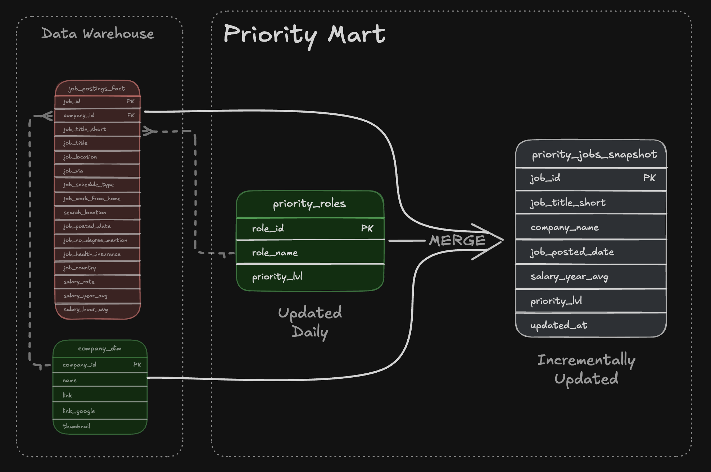
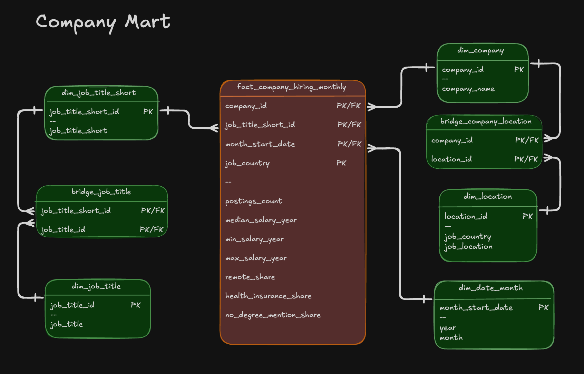

### [2_DW_Mart_Build/](./2_DW_Mart_Build/) - 🏗️ Data Warehouse & Mart Build: Production ETL Pipeline

An end-to-end data engineering pipeline that transforms raw CSV files from Google Cloud Storage into a normalized star schema data warehouse, then builds analytical data marts.


---

## Architectural Overview

Querying raw, unnormalized staging files directly at scale introduces severe bottlenecks: inconsistent string literals, repeated multi-join overhead, and broken aggregations when dealing with many-to-many relationships (such as a single job posting requiring multiple skills, or a single company operating across hundreds of locations).

To solve this, the pipeline implements a two-tier analytical architecture inside **DuckDB** (`dw_marts.duckdb`), orchestrated via a single idempotent master script (`build_dw_marts.sql`):

1. **Core Enterprise Data Warehouse (`main` schema):** Acts as the normalized single source of truth. Enforces data type contracts, primary keys, and foreign key referential integrity across facts and dimensions.
2. **Analytical Serving Layer (`*_mart` schemas):** Isolates four purpose-built data marts—each engineered at a specific grain and update strategy (Full Refresh vs. Incremental `MERGE`) to match how BI tools and analysts query data in production.

---

## Repository Structure & Pipeline Orchestration

```text
2_DW_Mart_Build/
├── 01_create_tables_dw.sql        # DDL: Core Star Schema & bridge table definitions
├── 02_load_schema_dw.sql          # Ingestion: Remote GCS CSV extraction via DuckDB httpfs
├── 03_create_flat_mart.sql        # Serving (OBT): Denormalized wide table for ad-hoc exploration
├── 04_create_skills_mart.sql      # Serving (Cube): Monthly skill demand with strictly additive measures
├── 05_create_priority_mart.sql    # Serving (Snapshot): Initial build of priority role tracking tables
├── 06_update_priority_mart.sql    # Serving (Upsert): Incremental synchronization via MERGE INTO
├── 07_create_company_mart.sql     # Serving (Dimensional): Company hiring mart with surrogate keys & bridges
├── build_dw_marts.sql             # Orchestrator: Master CLI execution script
└── README.md
```

---

## Data Modeling & Pipeline Stages

### 1. Core Data Warehouse (`01_create_tables_dw.sql`, `02_load_schema_dw.sql`)

The foundation of the pipeline extracts raw CSV files directly over HTTPS from Google Cloud Storage (`storage.googleapis.com/sql_de/...`) using DuckDB's `read_csv(..., AUTO_DETECT=true)` and loads them into a normalized Star Schema.


* **Fact Table (`job_postings_fact`):** Transaction-level grain (`1 row = 1 job_id`). Stores quantitative measures (`salary_year_avg`, `salary_hour_avg`), boolean job attributes (`job_work_from_home`, `job_health_insurance`, `job_no_degree_mention`), and degenerate location/title descriptors.
* **Dimensions (`company_dim`, `skills_dim`):** Hold unique company profiles and skill taxonomies.
* **Many-to-Many Bridge (`skills_job_dim`):** Resolves the $M:N$ relationship between job postings and required skills using a composite primary key `(job_id, skill_id)` with foreign key constraints pointing back to the fact and skill dimension tables.

---

### 2. Flat Mart — One Big Table Pattern (`03_create_flat_mart.sql`)

While normalized schemas optimize storage and referential integrity, ad-hoc exploration often benefits from a single denormalized wide table without requiring 4-way joins.


* **Grain:** `1 row per job_id`.
* **Implementation:** Joins `job_postings_fact` with `company_dim` and collapses the many-to-many skill bridge into an inline aggregated list (`skills_list`) per posting.

---

### 3. Skills Mart — Additive Time-Series Cube (`04_create_skills_mart.sql`)

Built to track longitudinal demand for technical skills across different roles over time.


* **Grain:** `(skill_id, month_start_date, job_title_short)`
* **Date Dimension (`dim_date_month`):** Extracts `DATE_TRUNC('month', job_posted_date)::DATE` as the primary key alongside pre-computed temporal attributes (`year`, `month`, `quarter`, `quarter_name`, `year_quarter`).
* **Design Decision — Strictly Additive Measures:** Instead of storing pre-calculated percentages in the fact table (`fact_skill_demand_monthly`), boolean flags (`job_work_from_home`, `job_health_insurance`, `job_no_degree_mention`) are cast to `1`/`0` integers inside a staging CTE and aggregated via `SUM()`. Because every measure in this mart is an additive count (`postings_count`, `remote_postings_count`, `health_insurance_postings_count`, `no_degree_postings_count`), downstream BI tools (Power BI, Tableau) can safely roll the data up by quarter, year, or skill type without committing the "average of averages" mathematical error.

---

### 4. Priority Mart — Incremental State Synchronization (`05_...` & `06_update_priority_mart.sql`)

Models an operational mart where stakeholders maintain a configuration table (`priority_mart.priority_roles`) defining target roles and priority tiers (`priority_lvl`), which must stay synchronized with a large downstream snapshot table (`priority_jobs_snapshot`).



* **Grain:** `1 row per tracked job_id`.
* **Design Decision — Incremental `MERGE INTO` vs. Full Refresh:** Dropping and recreating large snapshot tables daily wastes compute and destroys audit metadata (`updated_at`). Script `06_update_priority_mart.sql` uses a staging query (`src`) joining the warehouse against the latest `priority_roles` rules and executes a single atomic `MERGE INTO priority_mart.priority_jobs_snapshot AS tgt`:
  * **`WHEN MATCHED AND tgt.priority_lvl IS DISTINCT FROM src.priority_lvl`:** Updates the priority level and refreshes the `updated_at` timestamp only on modified records.
  * **`WHEN NOT MATCHED`:** Inserts newly qualified job postings.
  * **`WHEN NOT MATCHED BY SOURCE`:** Automatically prunes obsolete rows from the snapshot when a role is removed from `priority_roles`.

---

### 5. Company Mart — Surrogate Keys, Hierarchies & Non-Additive Metrics (`07_create_company_mart.sql`)

Architected to analyze monthly company hiring velocity, salary distributions, and benefit shares across countries and roles.



* **Fact Grain:** `(company_id, job_title_short_id, month_start_date, job_country)`
* **Key Engineering Implementations:**
  1. **Deterministic Surrogate Key Generation & SQL Execution Order:** Raw postings in `job_postings_fact` lack foreign key IDs for `job_title_short`, `job_title`, and `(job_country, job_location)`. Because SQL evaluates window functions (`ROW_NUMBER()`) *before* `SELECT DISTINCT`, running both in the same query scope generates sequential IDs across all ~787,000 raw rows before deduplication occurs. To guarantee true 1-to-1 surrogate keys, each dimension pipeline first isolates unique natural keys inside a `SELECT DISTINCT` CTE (`WHERE col IS NOT NULL`), and applies `ROW_NUMBER() OVER (ORDER BY ...)` in the outer query.
  2. **Bridge Hierarchy Resolution:**
     * `bridge_job_title`: Maps standardized role categories (`dim_job_title_short`) to thousands of raw job title variations (`dim_job_title`) via composite key `(job_title_short_id, job_title_id)`.
     * `bridge_company_location`: Maps companies (`dim_company`) to every unique `(job_country, job_location)` pair (`dim_location`) where they actively recruit.
  3. **Statistical & Proportional Fact Aggregations:** Designed for direct executive consumption at the fixed company-month-country-role grain, `fact_company_hiring_monthly` computes salary spread (`MEDIAN(salary_year_avg)`, `MIN`, `MAX`) and converts boolean perk columns into `1.0`/`0.0` floats in a preparation CTE to calculate exact proportional shares (`AVG(is_remote) AS remote_share`, `health_insurance_share`, `no_degree_mention_share`).

---

## Production Engineering Practices Applied

* **Idempotency:** Every DDL/DML build script starts with `DROP SCHEMA IF EXISTS <schema> CASCADE;` (or `DROP TABLE IF EXISTS`), ensuring the entire pipeline can be re-executed from scratch at any time without state collisions or duplicate insertions.
* **Referential Integrity:** All dimensional and bridge tables explicitly enforce `PRIMARY KEY`, composite `PRIMARY KEY (col_a, col_b)`, and `FOREIGN KEY ... REFERENCES` constraints.
* **Defensive `NULL` Filtering:** Natural keys and composite grain columns are strictly filtered (`IS NOT NULL`) prior to surrogate key generation and fact aggregation to prevent constraint violations and orphan bridge records.
* **Git Feature-Branch Workflow:** Developed iteratively across isolated feature branches (`feature/data-warehouse`, `feature/skills-mart`, `feature/company-mart`) before merging into `main`.

---

## Running the Pipeline Locally

Ensure [DuckDB CLI](https://duckdb.org/docs/installation/) is installed and available in your system `PATH`. From the `2_DW_Mart_Build` directory, execute the master build script:

```bash
duckdb dw_marts.duckdb -c ".read build_dw_marts.sql"
```

---

## Acknowledgments

Dataset and architectural diagrams provided by [Luke Barousse's](https://www.lukebarousse.com/) Data Engineering course. SQL pipeline implementation, incremental `MERGE` workflows, and the end-to-end `company_mart` dimensional build (`07_create_company_mart.sql`) were engineered by **Abdullah Mahmoud Mohamed**.
