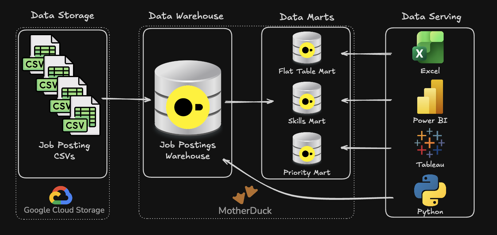

# Data Engineering Projects

Hands-on projects to reinforce core data engineering concepts from the SQL for Data Engineering course.

# Projects

## [1_EDA/](./1_EDA/) - Exploratory Data Analysis

SQL-driven analysis of data engineer job market trends using advanced querying techniques.

**Skills**: Complex joins, aggregations, analytical functions, data quality validation

### [2_DW_Mart_Build/](./2_DW_Mart_Build/) - End-to-End OLAP Data Warehouse & Analytical Marts

A multi-layer SQL data engineering pipeline built in **DuckDB** that extracts raw job posting CSVs from Google Cloud Storage (`httpfs`), normalizes them into a core **Kimball Star Schema Data Warehouse**, and transforms the warehouse into four purpose-built **Analytical Serving Marts**:
- **Core Data Warehouse (`main`):** Fact and dimension tables enforcing referential integrity (`PRIMARY KEY` / `FOREIGN KEY`) and many-to-many bridge relationships (`skills_job_dim`).
- **Flat Mart (`flat_mart`):** Denormalized One-Big-Table (OBT) with inline aggregated skill arrays for fast ad-hoc exploration.
- **Skills Mart (`skills_mart`):** Monthly time-series cube engineered with strictly additive measures (`SUM`/`COUNT`) for safe BI roll-ups across quarters and years.
- **Priority Mart (`priority_mart`):** Operational role-tracking snapshot maintained via incremental `MERGE INTO` upsert synchronization (`INSERT`, `UPDATE`, and `DELETE WHEN NOT MATCHED BY SOURCE`).
- **Company Mart (`company_mart`):** Full dimensional mart featuring deterministic window-function surrogate keys (`ROW_NUMBER()` over deduplicated CTEs), $M:N$ hierarchy bridges (`bridge_job_title`, `bridge_company_location`), salary spread aggregations (`MEDIAN`, `MIN`, `MAX`), and proportional benefit shares.

**Skills:** Kimball Dimensional Modeling (Star Schema, Bridge Tables, Surrogate Keys), Idempotent ETL Orchestration, Incremental `MERGE INTO` Upserts, Multi-Grain Mart Architecture, DuckDB OLAP & `httpfs` Cloud Ingestion
